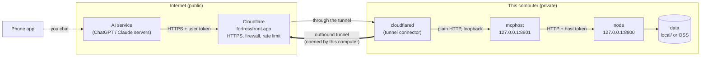
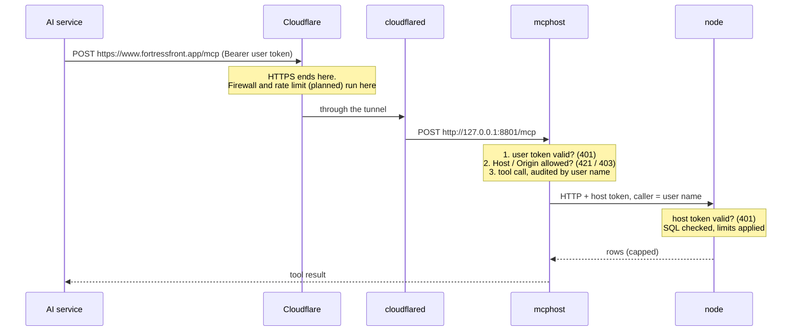

# service/mcphost/service

The **MCP front door of a node**. It lets an AI client (Claude, Copilot, ...) discover, inspect and query the datasets of one node through the [Model Context Protocol](https://modelcontextprotocol.io), over streamable HTTP.

The host holds **no data and no logic of its own**. Every tool is answered by a `NodeClient` (see [../../node/client/_ABOUT.md](../../node/client/_ABOUT.md)) talking to the [node service](../../node/service/_ABOUT.md). The host only does four things: authenticate the AI user, expose tools, translate errors for the AI, and leave an audit trail.

| File | Content |
|---|---|
| `service.py` | `McpHostService`, the lifecycle: pick the node, check it at start, build the MCP server, mount auth |
| `tools.py` | `build_server` (the four tools), `MCPGuard` (timing, logging, error translation), result shaping helpers |
| `instructions.py` | The texts the AI reads: server instructions and the description of each tool |
| `http.py` | `serve`: start the service, run uvicorn, stop the service |
| `tests/` | Unit tests (`fakes.py` holds a fake `NodeClient`) |

## Components

```
AI client ──► HTTP (streamable MCP)
                │
                ▼
        BearerAuthMiddleware ──► Principal (which user / device)
                │
                ▼
        MCPServer  (tools: list_datasets, get_schema, get_quality, query)
                │
                ▼
        MCPGuard   (log start, time, translate errors, log result)
                │
                ▼
        NodeClient (HttpNodeClient, or any NodeClient)
                │
                ▼
        Node service ─► catalog / DRA query
```

## Lifecycle (`McpHostService`)

1. **Construct**: choose the node from `setting.nodes`, the first one unless `node` names another (unknown name → `ValueError`). A ready-made `client` can be injected (tests, in-process); otherwise an `HttpNodeClient` is built from the node setting at start. `auth` is a `TokenAuth`, needed only for `asgi_app`.
2. **`start()`** (`_start`) fails fast on a bad deployment:
   - `client.health()` must say the node `is_running`. The health route needs no token, so this only proves the node is up.
   - `client.list_sources()` is called next. It needs the token, so this is what proves the host's token for the node is valid.
   - Then `build_server` creates the MCP server. If anything fails, the client the host created is released and the error is re-raised.
3. **`asgi_app(host)`** returns the Starlette app of the MCP server. It refuses to build when the service is not running, or when there is **no auth** (it would serve data to anyone). It adds `BearerAuthMiddleware` with **no public paths**: every route needs a token. The transport only accepts a `Host` (and `Origin`) header that is loopback or listed in `setting.public_hosts`, see [Network architecture](#network-architecture).
4. **`stop()`** drops the server and closes the client, but only if the host created it. An injected client is never closed by the host.
5. **`health()`** adds the node's name, whether it is reachable and its state to the base service health.

`serve(service, host, port, log_level)` in `http.py` is the standard entry: `start()` → `uvicorn.run(asgi_app)` → `stop()` in `finally`. Host and port default to the setting (`127.0.0.1:8801`).

## Two layers of tokens

| Token | Held by | Checked by |
|---|---|---|
| **User token** (one per device) | The AI client | The host, `BearerAuthMiddleware` with `setting.auth` |
| **Host token** | The host | The node, its own auth |

The two master keys must differ: a user token is never accepted by the node. The authenticated `Principal` is stored on the request scope; `_caller_of(ctx)` reads its name for each tool call (`None` for an in-process transport without an HTTP request).

## Network architecture

This section explains how a request travels from an AI app on a phone to the data, and which part guards what. No networking background is assumed.

### The big picture



Three facts explain most of the design:

1. **The phone never talks to this computer.** When you chat in the ChatGPT app, the *OpenAI servers* call `https://www.fortressfront.app/mcp`. That is why the phone's own network (Wi-Fi, Tailscale, VPN) does not matter, and why the address has to be reachable from the public internet.
2. **Nothing on this computer listens to the internet.** `mcphost` and `node` listen on `127.0.0.1` ("loopback"), an address that only programs on the same computer can reach. Instead of opening a port on the router, `cloudflared` makes an *outbound* connection to Cloudflare, like a browser does, and Cloudflare sends requests back through that connection. No public IP, no port forwarding, nothing for a port scanner to find.
3. **Only `mcphost` is behind the tunnel.** `node` is never reachable from outside, even through Cloudflare. It only answers `mcphost` on the same computer.

### The parts

| Part | What it is | Where it is set up |
|---|---|---|
| `fortressfront.app` | The domain name. Its DNS is managed by Cloudflare, so Cloudflare receives every request to it | Cloudflare dashboard, DNS |
| Cloudflare edge | The public front. Provides the HTTPS certificate, and can block, rate-limit or filter by IP before a request reaches this computer | Cloudflare dashboard, Security (WAF, rate limiting) |
| Tunnel + `cloudflared` | A small program on this computer that keeps an outbound connection to Cloudflare. A *Public Hostname* rule says "requests for `www.fortressfront.app` go to `http://127.0.0.1:8801`" | Cloudflare dashboard, Zero Trust, Networks, Tunnels; `cloudflared` runs as a macOS service |
| `mcphost` | This service. Checks the user token and the Host header, then exposes the four tools | `settings/services.yaml`, `mcphost:` |
| `node` | The data service. Only reachable on loopback, checks the host token | `settings/services.yaml`, `node:` |

### Life of one request



Two encryption hops are worth knowing: AI service to Cloudflare is HTTPS, and Cloudflare to `cloudflared` is encrypted by the tunnel. The last hops (`cloudflared` to `mcphost` to `node`) are plain HTTP, which is safe only because they stay inside this computer.

### Who checks what

| Check | Done by | Answers with | Protects against |
|---|---|---|---|
| Firewall, rate limit, IP allow-list | Cloudflare | 403 / 429 / block page | Scanners, brute force, unknown callers (**not configured yet**) |
| Path (only `/mcp` is forwarded) | Cloudflare tunnel rule, later also WAF | 404 | Anyone probing other URLs |
| User token (`setting.auth`) | `mcphost`, `BearerAuthMiddleware` | 401 | Anyone without a token. Runs first, so a request without a token gets 401 even on a wrong Host |
| Host and Origin header (`setting.public_hosts`) | `mcphost`, MCP transport | 421 / 403 | A browser page tricked into calling the host under another name ("DNS rebinding"). The Host must be loopback or listed |
| Host token | `node`, its own auth | 401 | Anything other than `mcphost` talking to `node` |
| SQL guard, limits, session per user | `node`, DRA | error text for the AI | Writes, file access, runaway queries |

No single layer is trusted alone: if the Cloudflare rules are wrong, the token still blocks; if a token leaks, the node limits still apply and the data is read-only.

### What you configure

```yaml
# settings/services.yaml
mcphost:
  host: 127.0.0.1          # keep loopback, never 0.0.0.0
  port: 8801               # must match the tunnel's Public Hostname target
  public_hosts:            # names the tunnel forwards, anything else gets 421
    - www.fortressfront.app
```

- **A new public name**, e.g. `mcp.fortressfront.app`: add a Public Hostname in the tunnel pointing to `http://127.0.0.1:8801`, **and** add the name to `public_hosts`, then restart `mcphost` (`public_hosts` is not hot-reloaded, only `auth` is).
- **A new device or AI app**: add an entry under `mcphost.auth.tokens`, then `fortress auth show <name> --service mcphost` prints the token. It is derived from the master key, never stored.
- **Revoke**: set `revoked: true` for the token, effective within a second without restart.

### What the status codes mean

| You see | Meaning |
|---|---|
| DNS error ("could not resolve host") | The name has no DNS record, i.e. no Public Hostname for it in the tunnel |
| 502 / 530 from Cloudflare | The tunnel is down or `mcphost` is not running on the port the tunnel points to |
| 401 `{"error":"unauthorized"}` | The request reached `mcphost`; token missing, wrong, expired or revoked. This is the healthy answer to a request without a token |
| 421 `Invalid Host header` | The request reached `mcphost`, but the name is not in `public_hosts` |
| 403 `Invalid Origin header` | A browser-style `Origin` is not loopback or `https://<public host>` |
| 200 with `serverInfo` | All layers passed |

### Current state and what is still missing

- Done: tunnel, HTTPS, `public_hosts`, user tokens, host token, loopback-only services.
- **Not done, do before real use**: Cloudflare rate limiting and the path/IP rules; a memory ceiling for the process (`MemoryMax`, DuckDB's own limit does not cover everything); read-only cloud credentials scoped to the dataset prefixes (the real backstop if a token leaks); expiry and rotation of user tokens.
- A leaked user token lets its holder read **all** datasets of the node until it is revoked; there is no per-dataset access list.
- Never commit the tunnel token, the master key files (`local/.auth/*.key`) or `services.yaml` with host tokens in it.

## Tools

The AI is guided to the flow `list_datasets` → `get_schema` → `query`, with `get_quality` to judge completeness. Datasets are always named `<source>.<dataset>`, which is also the table name in SQL (`_split` validates this form).

| Tool | Node calls | Returns |
|---|---|---|
| `list_datasets(source?)` | `list_datasets` | dataset, description, frequency, partition keys |
| `get_schema(dataset)` | `get_dataset`, `list_definitions` | Description, partition keys, and `definitions`: each distinct schema (columns and types) with its `partition_count` and the min/max of each partition key. Sorted by partition count, the most common schema first |
| `get_quality(dataset, limit=20)` | `list_qualities` | Per partition file, newest first (limit clamped 1..200): rows, complete rows, duplicates, columns with a NULL rate, constant columns, all-NULL columns. `checked: false` when a file has no quality record |
| `query(sql)` | `query(sql, caller=)` | The rows of ONE read-only SELECT (DuckDB). Capped in rows and size, `truncated` says so |

Notes:
- `_summarize_quality` reduces the full quality record to key metrics so the answer stays small for the AI.
- Partition keys are VARCHAR in SQL; the tool descriptions tell the AI to `CAST` them. Columns missing in some partitions read as NULL.
- The tool functions are plain `def`, the MCP SDK runs them in a worker thread so a slow node call does not block the event loop.
- **Read-only by construction**: there is no write tool, and SQL validation, session isolation, row/size caps and timeout are the node's DRA engine's job, not the host's.
- `query` passes the user's name as `caller`, so the node runs the query in a session of its own and audits it by that name.

## Error handling and logging (`MCPGuard`)

Every tool call runs through `MCPGuard.run`:

1. Log `tool start` with the tool, arguments (strings clipped to 500 chars, so long SQL cannot flood the log) and the caller.
2. Time the call.
3. On success log `tool ok` with `elapsed_ms` plus tool metrics (`datasets`; `rows` and `truncated` for `query`).
4. On failure log `tool failed` (warning) and raise a `ToolError`:

| Error from the node side | Message the AI gets |
|---|---|
| Source/dataset not found, bad request, SQL rejected, query failed, query timeout, all sessions busy | The **original message**: it is worded for the caller, so the AI can fix its next call |
| Node rejected the host token | Fixed: "The node rejected the token of this host." |
| Node unreachable or too slow | Fixed: "The node is unreachable or too slow, try again later." |
| Anything else | Fixed: "Unexpected error in the node host." |

Only caller-worded errors pass their text through. Anything about the host/node itself (token, network, bugs) is hidden from the AI and only goes to the log.

## Instructions (`instructions.py`)

The server instructions and each tool description are the AI's only manual, so they carry the rules that matter: dataset naming, VARCHAR partition keys, per-partition schema differences, single SELECT/WITH only (no writes, SET, ATTACH or file functions), results not saved, truncation, query timeout. Change behavior hints here, not in the tools.

## Design rules

- **No data, no SQL logic** in the host. If a rule is about data access, it belongs in the node.
- **One host, one node.** To serve several nodes, run several hosts.
- **Fail at start**, not at the first AI call: node down, wrong endpoint and wrong token are all caught by `start()`.
- **No auth, no app.** `asgi_app` never serves without a `TokenAuth`.
