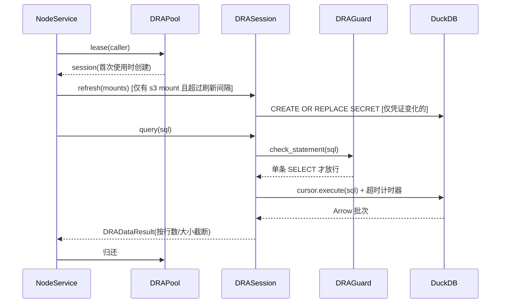
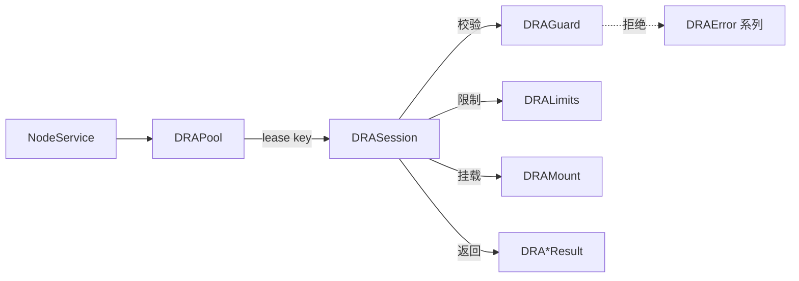

# DRA (Data Research and Analytics)

数据节点上的只读分析查询模块。把已挂载的 parquet 数据集(本地文件或 S3)暴露成内嵌 DuckDB 引擎里的视图 `<source>.<dataset>`,让调用方用一条 `SELECT` 查询,同时限制它能读什么、能用多少资源。

`NodeService` 通过 `DRAPool` 获取 `DRASession` 来执行查询。

## 工作原理

一个 `DRASession` 就是一个被锁死的内存 DuckDB。创建时把数据集挂成视图,之后调用方只能对这些视图发单条 `SELECT`,引擎本身被配置成读不了挂载范围以外的任何东西。

**创建 session 的顺序**(顺序不能换,配置一旦锁定就不能再改):

1. 逐个校验数据集名和挂载(`DRAGuard`),任何一个不合格就整体拒绝,此时引擎还不存在,不留残余。
2. 建内存 DuckDB。有 s3 挂载时先 `LOAD httpfs`,并为每个 s3 挂载建一个 secret。
3. `SET temp_directory=''`(不落盘)。
4. `SET allowed_directories=[各挂载的 scope]`。
5. `SET enable_external_access=false`,关闭扩展自动安装和自动加载。
6. 设内存和线程上限,最后 `SET lock_configuration=true`。
7. 每个挂载建成视图 `"<source>"."<dataset>"`。

所以挂载必须一次给全,事后不能追加。

## 调用流程

## 组件

| 文件 | 组件 | 作用 |
| --- | --- | --- |
| (在 `app/resource/asset/_common/_mount.py`) | `DRAMount` | DRA 依赖 `app.resource.asset` 取得它。一个数据集的挂载描述:`scheme`(`file`/`s3`)、`pattern`(glob)、`scope`(允许访问的前缀)、`partitions`(hive 分区键)、S3 的 `endpoint`/`region`/`url_style`/凭证。不可变,禁止多余字段;构造时校验 `scope` 以 `/` 结尾且无通配符、`pattern` 在 `scope` 内、file 不能带远程字段和凭证、`key_id` 与 `secret` 成对。`secret`、`session_token` 为 `SecretStr`,不出现在 `repr` 和导出里。 |
| `guard.py` | `DRAGuard` | 安全校验,不信任输入。`check_statement` 只放行单条 `SELECT`;`check_mount` 重新校验挂载(绝对路径、无 `..`、无非法字符、pattern 固定前缀必须在 scope 内、S3 必须以 `s3://` 开头并指明 bucket);`split_dataset_name` / `check_identifier` 校验 `<source>.<dataset>` 命名并拒绝引擎保留的 schema;`stringify_sql` 做 SQL 字符串转义。 |
| `limits.py` | `DRALimits` | 一个会话的资源上限:`timeout_seconds`(120)、`max_rows`(10000)、`max_result_mb`(128)、`memory_limit_mb`(1024)、`threads`(2)。不可变。 |
| `session.py` | `DRASession` | 核心,机制见下文。提供 `definition(name)` 查实时 schema、`query(sql)` 执行查询、`refresh(mounts)` 校验挂载未变并替换变化的 S3 凭证、`close()`;属性 `names`(已挂载的数据集)、`has_secrets`(是否有 s3 挂载)、`refreshed_at`(上次构建或刷新的单调时间)。线程安全,可用作上下文管理器。 |
| `pool.py` | `DRAPool` | 有上限的会话池,每个 key 一个会话。`lease(key)` 借用(首次使用时由 factory 创建);池满时淘汰最久未使用的空闲会话,空闲超过 `max_idle_seconds` 的会话在下次借用时关闭;借出中的会话不会被淘汰,全部繁忙时抛 `DRABusyError`;`reset()` 关闭空闲会话并标记借出的会话,最后一个使用者归还时关闭。 |
| `result.py` | `DRA*Result` | 返回给调用方的不可变结果类型:`DRADataResult`(查询结果,含 `columns`、`types`、`rows`、`truncated`、`truncated_by`、`elapsed_ms`)、`DRADefinitionResult` 与 `DRAColumnDefinition`(数据集 schema)、`DRADatasetResult`(挂载的数据集信息)、`DRAQualityResult`(数据质量记录)。远程调用方只依赖这些类型,不需要 `duckdb`。 |
| `errors.py` | `DRAError` 系列 | `DRAError` 为基类;`DRARejectedError`(语句或挂载在到达引擎前被拒绝)、`DRAQueryError`(引擎执行失败)、`DRAQueryTimeoutError`(超时被中断)、`DRABusyError`(所有会话都在查询,稍后重试)、`DRARefreshError`(凭证刷新失败,消息里不带凭证)。 |

## 各部件的机制

### `DRAMount`:挂载描述

只描述"读哪里、怎么读",不含引擎逻辑,放在 `resource/asset` 下,所以 `app.resource` 不需要加载 `duckdb`。由 `asset.get_dra_mount()` 产出:本地 asset 给 `file` 挂载,OSS asset 给 `s3` 挂载(阿里云凭证通过 `identity.as_secret()` 取,OSS 用 `vhost` 风格)。

### `DRAGuard`:入口校验

- **语句**:用 DuckDB 自己的解析器 `extract_statements`,必须恰好一条且类型是 `SELECT`(`WITH` 也属于 `SELECT`)。`INSERT`、`COPY`、`SET`、`ATTACH`、`CREATE SECRET`、`INSTALL` 等都在这一步被拒,不会到达引擎。
- **数据集名**:`<source>.<dataset>`,各段必须匹配 `[a-z_][a-z0-9_]{0,62}`,且 source 不能是 `main`、`temp`、`system` 等引擎自带的 schema。
- **挂载**:本地路径必须是绝对路径、无 `..`、无引号反斜杠和控制字符;pattern 去掉通配符部分后的固定前缀必须落在 scope 内(先 `resolve`,所以符号链接越出 scope 也会被拒);s3 路径必须以 `s3://` 开头并指明 bucket。分区键同样要通过标识符校验。
- **转义**:`stringify_sql` 把单引号加倍,所有拼进 SQL 的路径和凭证都经过它。

### `DRASession`:引擎与沙箱

**读取范围**

- 本地和 S3 的 scope 都放进 `allowed_directories`,外部访问关闭后,引擎只能读这些前缀,`read_csv`、`glob`、`http://` 读 scope 外的东西都会失败。
- 每个 s3 挂载对应一个 `TYPE s3` 的 secret(`dra_s3_<序号>`),带 `SCOPE`,所以凭证只对该前缀生效。只用 `TYPE s3`,因为它的 `secret` 和 `session_token` 在 `duckdb_secrets()` 里是脱敏的。

**视图**

- 每个挂载是 `SELECT * FROM read_parquet(glob, ..., union_by_name=true)`,多个文件按列名合并,缺列补 NULL。
- 声明了 `partitions` 的挂载开 hive 分区且不做类型推断(`hive_types_autocast=false`),分区列一律是 `VARCHAR`,需要时由 SQL 自己转。
- 视图是惰性的:文件被删或读不了的错误出现在 `definition` 或 `query` 时,而不是挂载时。

**执行一条查询**

1. 在会话锁内:确认未关闭、`check_statement`、建一个新 cursor,然后释放锁。
2. 在锁外用这个 cursor 执行,所以同一 session 的多个查询可以并行。
3. 启动一个 `threading.Timer`,到 `timeout_seconds` 对 **这个 cursor** 调 `interrupt()`(中断必须打在执行查询的 cursor 上,打在父连接上无效)。被中断且超时标记已置位就抛 `DRAQueryTimeoutError`,其他引擎错误抛 `DRAQueryError`。
4. 用 Arrow reader 按 1024 行一批读取:先按 `max_rows` 截断,再按 `max_result_mb` 截断(按本批能容纳的比例保留一部分行,上限很小时也能返回点东西)。被截断时 `truncated=True`,`truncated_by` 为 `rows` 或 `size`。
5. `HUGEINT` / `UHUGEINT`(整数 `SUM` 的结果)在 Arrow 里是 `Decimal(38,0)`,序列化成 JSON 会变成字符串,所以转回 Python `int`。

**凭证刷新 `refresh(mounts)`**

- 配置虽被锁定,`CREATE OR REPLACE SECRET` 仍然可用,这是刷新凭证的依据。
- 先对每个挂载重新做 scope 校验,数据集集合或 scope 与创建时不一致就抛 `DRARejectedError("mounts changed")`,调用方应开新 session。
- 对每个 s3 挂载,把"会写入的那条替换语句"哈希后与上次比较,不同才执行。只存哈希,不存明文。
- 替换失败时旧 secret 保留、`refreshed_at` 不更新,抛 `DRARefreshError`,消息只带数据集名和异常类型(语句和引擎原文都含密钥)。
- 替换只对之后新发的请求生效,引擎已缓存的对象元数据和列举结果不会因此失效。

**节点侧的调用**:`NodeService.query` 在 `lease` 内、查询前调用 `_refresh_session`。没有 s3 挂载的 session 不刷新;距上次刷新不到 `dra.refresh_interval_seconds`(默认 120 秒)也不刷新,因为阿里云凭证客户端自己缓存并提前刷新,取凭证很便宜。刷新时只对 session 已挂载的数据集重新取 mount,不重新列举文件。

**其他**

- `definition(name)`:`DESCRIBE` 视图得到实时 schema,附上声明的分区键。
- `close()` 幂等;关闭后任何调用都抛 `DRAError("session is closed")`。

### `DRAPool`:会话池

- 每个 key(调用方的 token 名)一个会话,同一调用方的查询共享一个引擎,不同调用方互相隔离。
- 会话由 factory 在池锁内创建,所以同一个 key 不会出现两个会话;factory 失败时不会牺牲池里健康的会话。
- 池满时淘汰最久未使用的**空闲**会话(`lru`);空闲超过 `max_idle_seconds` 的在下一次借用时关闭(`idle`);关闭放在锁外做,因为可能较慢。
- 借出中的会话不会被淘汰;所有会话都忙且来了新 key 时抛 `DRABusyError`。
- `reset()` 关闭空闲会话,借出的标记为 `retired`,最后一个使用者归还时关闭。
- `stats()` 给出会话数和忙碌会话数,`NodeService.health()` 会带上。

### `DRALimits` 与节点配置

`DRALimits` 自己的默认值(超时 120 秒、线程 2)只在不传 limits 时用。节点里实际生效的是 `services.yaml` 的 `node.dra`(`DRASetting`:超时 30 秒、线程 4、`max_sessions`、`max_session_idle_seconds`、`refresh_interval_seconds`),由 `NodeService` 转成 `DRALimits`。`memory_limit_mb` 只约束由缓冲管理的算子,管不住所有分配。

### `DRA*Result`

不可变的 pydantic 类型,远程调用方只依赖它们,不需要 `duckdb`。节点的 HTTP 层按类型名和状态码把错误传回去(400 语句被拒或执行失败、408 超时、503 繁忙)。`DRARefreshError` 没有专门状态码,走 500 "internal error",细节只写节点日志。

## 安全边界

- 只接受单条 `SELECT`,其他语句类型一律拒绝。
- 引擎只能读各挂载的 `scope`,关闭外部访问、关闭扩展自动加载、禁止落盘,配置在创建后锁定。
- 挂载在 `DRAMount` 和 `DRAGuard` 两处都校验。
- 凭证用 `SecretStr`,不出现在日志、`repr`、导出里;刷新失败的异常也不带凭证。
- 超时、行数、结果大小、内存、线程都有上限。

**已知限制**

- `s3://bkt/ds/../other/o.parquet` 会在客户端被规范化为 `/bkt/other/o.parquet` 后读取,前缀检查是字面匹配,目前接受这个风险(节点上所有 token 都能读所有数据集)。
- 一个节点上所有 token 都能访问全部数据集,数据集白名单留到 mcphost 的 P4。
- 查询执行到一半时凭证过期不会被救回。
- 引擎缓存已读过的对象元数据和列举结果,凭证替换对这些缓存不生效。

## 测试

`tests/` 下按组件对应(`DRAMount` 的测试在 `app/resource/asset/_common/tests/test_mount_unit.py`):`test_result_unit.py`、`test_guard_unit.py`、`test_limits_unit.py`、`test_error_unit.py`、`test_pool_unit.py`、`test_session_basic_unit.py`、`test_session_s3_unit.py`。
