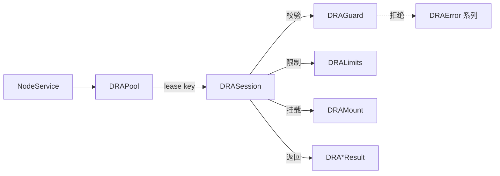

# DRA (Data Research and Analytics)

数据节点上的只读分析查询模块。把已挂载的 parquet 数据集(本地文件或 S3)暴露成内嵌 DuckDB 引擎里的视图 `<source>.<dataset>`,让调用方用一条 `SELECT` 查询,同时限制它能读什么、能用多少资源。

`NodeService` 通过 `DRAPool` 获取 `DRASession` 来执行查询。

## 调用流程

## 组件

| 文件 | 组件 | 作用 |
| --- | --- | --- |
| `mount.py` | `DRAMount` | 一个数据集的挂载描述:`scheme`(`file`/`s3`)、`pattern`(glob)、`scope`(允许访问的前缀)、`partitions`(hive 分区键)、S3 的 `endpoint`/`region`/`url_style`/凭证。不可变,禁止多余字段;构造时校验 `scope` 以 `/` 结尾且无通配符、`pattern` 在 `scope` 内、file 不能带远程字段和凭证、`key_id` 与 `secret` 成对。`secret`、`session_token` 为 `SecretStr`,不出现在 `repr` 和导出里。 |
| `guard.py` | `DRAGuard` | 安全校验,不信任输入。`check_statement` 只放行单条 `SELECT`;`check_mount` 重新校验挂载(绝对路径、无 `..`、无非法字符、pattern 固定前缀必须在 scope 内、S3 必须以 `s3://` 开头并指明 bucket);`split_dataset_name` / `check_identifier` 校验 `<source>.<dataset>` 命名并拒绝引擎保留的 schema;`stringify_sql` 做 SQL 字符串转义。 |
| `limits.py` | `DRALimits` | 一个会话的资源上限:`timeout_seconds`(120)、`max_rows`(10000)、`max_result_mb`(128)、`memory_limit_mb`(1024)、`threads`(2)。不可变。 |
| `session.py` | `DRASession` | 核心。创建时先校验全部挂载,再建内存 DuckDB,配置 S3 secret,把访问限定在各挂载的 scope 内、关闭外部访问、锁定配置,然后每个挂载建成一个 `read_parquet` 视图。提供 `definition(name)` 查实时 schema、`query(sql)` 执行查询(超时中断,按行数和大小截断)、`refresh(mounts)` 确认挂载未变、`close()`。线程安全,可用作上下文管理器。因为配置被锁定,挂载必须在创建时一次给全。 |
| `pool.py` | `DRAPool` | 有上限的会话池,每个 key 一个会话。`lease(key)` 借用(首次使用时由 factory 创建);池满时淘汰最久未使用的空闲会话,空闲超过 `max_idle_seconds` 的会话在下次借用时关闭;借出中的会话不会被淘汰,全部繁忙时抛 `DRABusyError`;`reset()` 关闭空闲会话并标记借出的会话,最后一个使用者归还时关闭。 |
| `result.py` | `DRA*Result` | 返回给调用方的不可变结果类型:`DRADataResult`(查询结果,含 `columns`、`types`、`rows`、`truncated`、`truncated_by`、`elapsed_ms`)、`DRADefinitionResult` 与 `DRAColumnDefinition`(数据集 schema)、`DRADatasetResult`(挂载的数据集信息)、`DRAQualityResult`(数据质量记录)。远程调用方只依赖这些类型,不需要 `duckdb`。 |
| `errors.py` | `DRAError` 系列 | `DRAError` 为基类;`DRARejectedError`(语句或挂载在到达引擎前被拒绝)、`DRAQueryError`(引擎执行失败)、`DRAQueryTimeoutError`(超时被中断)、`DRABusyError`(所有会话都在查询,稍后重试)。 |

## 安全边界

- 只接受单条 `SELECT`,其他语句类型一律拒绝。
- 引擎只能读各挂载的 `scope`,关闭外部访问、关闭扩展自动加载、禁止落盘,配置在创建后锁定。
- 挂载在 `DRAMount` 和 `DRAGuard` 两处都校验。
- 凭证用 `SecretStr`,不出现在日志、`repr`、导出里。
- 超时、行数、结果大小、内存、线程都有上限。

## 测试

`tests/` 下按组件对应:`test_mount_unit.py`、`test_result_unit.py`、`test_guard_unit.py`、`test_limits_unit.py`、`test_error_unit.py`、`test_pool_unit.py`、`test_session_basic_unit.py`、`test_session_s3_unit.py`。
