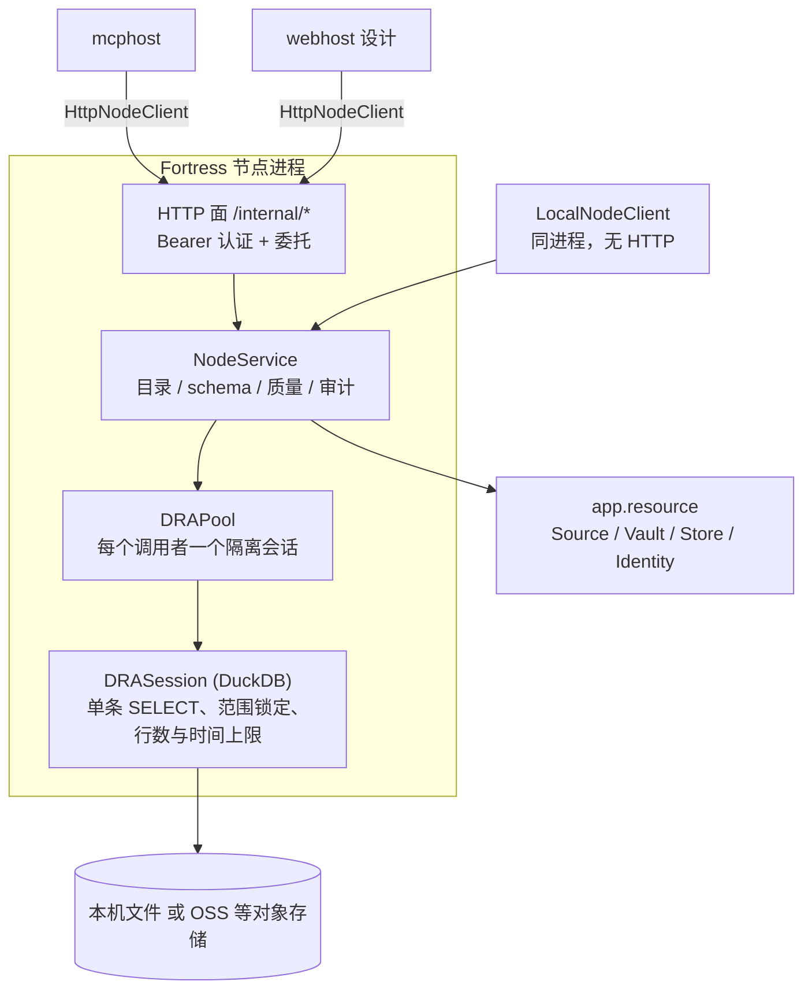
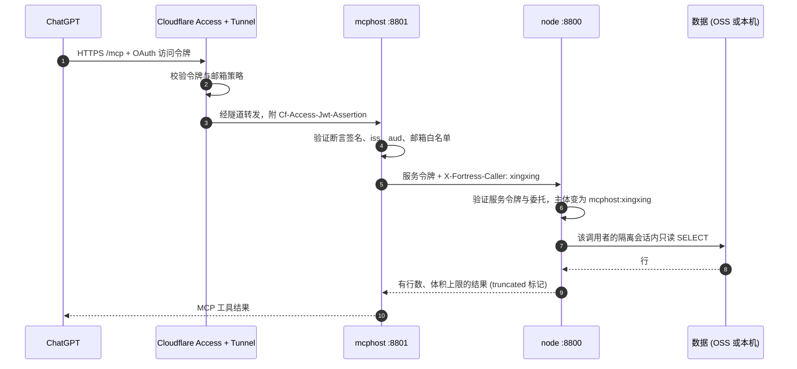
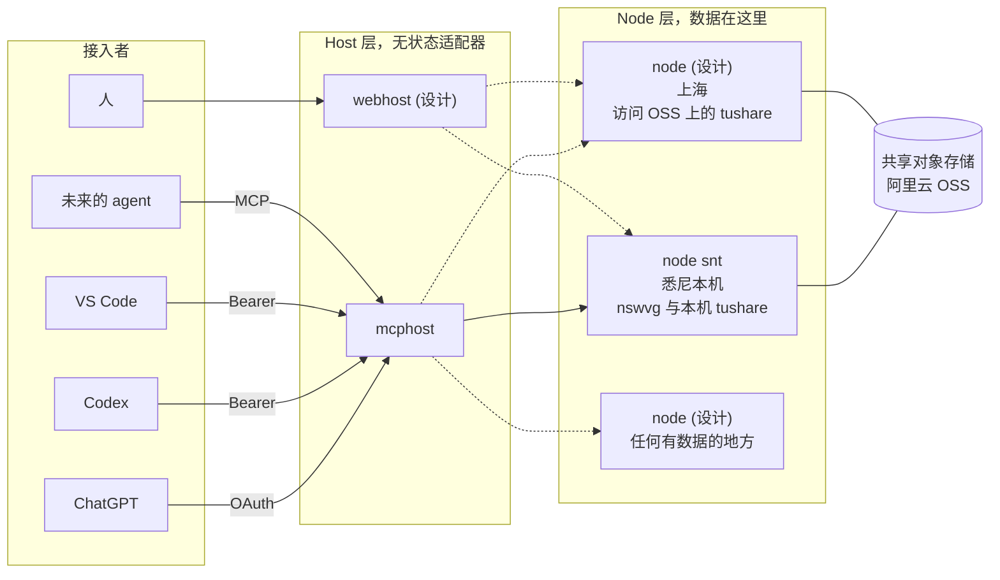

# Fortress 集群架构：节点、主机与接入者如何串在一起

一句话：**数据留在它所在的地方，问题和答案在网络上流动。**

Fortress 不是把全球数据搬到一个中心库，而是在每块数据旁边放一个 **node**（数据节点），
再在前面放若干个 **host**（协议适配器：mcphost、未来的 webhost），让任何
**接入者**（ChatGPT、Codex、VS Code、人）通过统一的契约问到数据。

## 1. 先说清楚：哪些已经有，哪些是蓝图

| 能力 | 状态 | 位置 |
|---|---|---|
| node：目录、schema、质量、只读 SQL 沙箱、按调用者审计 | 已实现 | [service/node](../../app/service/node) |
| 统一的节点契约 `NodeClient`（HTTP 与进程内两种实现） | 已实现 | [client/node.py](../../app/service/node/client/node.py) |
| mcphost：把 node 暴露成 MCP 工具（list_datasets、get_schema、get_quality、query） | 已实现 | [service/mcphost](../../app/service/mcphost) |
| 三层认证：Cloudflare Access、mcphost、node 各验各的 | 已实现 | [auth/module.md](../auth/module.md) |
| 公网入口：Cloudflare Tunnel，只出不进 | 已实现 | [network/cloudflare.md](../network/cloudflare.md) |
| mcphost 配置多个节点（`nodes` 列表，名字唯一） | 已实现，默认全部服务，`--node` 只服务指定的一个 | [service.py](../../app/service/mcphost/service/service.py) |
| mcphost 同时路由 / 聚合多个节点 | 已实现：`list_nodes`、`list_datasets` 扇出，其余按数据集自动路由（见第 5.3 节） | [tools.py](../../app/service/mcphost/service/tools.py) |
| webhost（人用的网页入口） | 骨架（`ServiceKind.WEBHOST`，node 上已预留 `webhost` 令牌），无逻辑 | [service/webhost](../../app/service/webhost) |
| 节点之间直接互相调用 | 刻意不做（见第 5.4、7 节） | - |

下文凡是标注「设计」的部分，都是在已实现契约之上的延伸，不是现状。

## 2. 角色

| 角色 | 是什么 | 持有什么 | 不持有什么 |
|---|---|---|---|
| **Node** | 数据节点，每块数据旁一个，名字由 `system.yaml` 的 `node` 决定（如 `snt`） | 数据源配置、云端凭证、查询引擎（DuckDB）、审计日志 | 不面向公网，只监听 `127.0.0.1` |
| **Host** | 协议适配器，一个或多个 node 的前台：mcphost（MCP）、webhost（网页） | 到 node 的服务令牌、对外身份验证 | 没有数据，没有云端凭证 |
| **接入者** | ChatGPT、Codex、VS Code、人、未来的任何 agent | 自己的令牌或 OAuth 身份 | 看不到 node，只看得到 host |
| **Cloudflare** | 公网入口：OAuth 授权服务器 + 隧道 | 域名、Access 策略 | 不持有 node 与数据的任何凭证 |
| **Machine** | 本机资源（磁盘、内存、CPU）状态服务 | - | - |

关键不对称：**凭证和数据只在 node 上，host 和接入者拿到的永远只是「问题」和「有上限的结果」。**

## 3. 单个节点内部

要点：

- 目录类问题（有哪些数据集、schema、质量报告）由资源层自己回答，不碰查询引擎；
  只有 `query` 才进入 DRA 沙箱（见 [session.py](../../app/service/node/dra/session.py)）。
- 每个调用者一个独立会话，节点为 `max_sessions` 设上限，满了返回 `DRABusyError`
  而不是拖垮节点。
- 数据集在引擎里是名为 `<source>.<dataset>` 的视图，AI 只需要学这一种命名。
- `NodeClient` 是**唯一的契约**：`HttpNodeClient`（跨网络）和 `LocalNodeClient`（同进程）
  返回同样的形状、抛同样的错误。host 不关心 node 在哪里。

## 4. 一次请求如何走

以 ChatGPT 在手机上问「tushare 的交易日历最近有没有缺数据」为例：

Codex 与 VS Code 走同一条链路的后半段：本机直连 `127.0.0.1:8801`，用静态 Bearer 令牌，
不经过 Cloudflare。详见 [auth/module.md](../auth/module.md)。

**同一条调用链上，每一层都留下记录**：mcphost 记录 `tool start / ok / failed`（含调用者、
耗时、行数、是否截断）；node 记录 `query ok / failed` 与会话开关。调用者名一路透传，所以
任何一次查询都能追到「谁，通过哪个 host，问了什么」。

## 5. 多节点：怎么把世界各地的节点串起来

### 5.1 拓扑

实线是现在已经工作的链路，虚线是设计。这是 **hub-and-spoke（星形）而不是 mesh（网状）**：
接入者和 host 在中心侧，node 是各自独立的辐条，辐条之间没有直连。

### 5.2 一个节点如何被识别、被接入

- 节点身份：每个 node 的 `system.yaml` 里有 `node: <名字>`（现在是 `snt`），它声明了这个节点
  拥有哪些 identities、sources、vaults、stores。
- host 侧登记：`services.yaml` 的 `mcphost.nodes[]` 里写 `name`、`endpoint`、`token`，名字应
  与该节点自己的 `node` 一致，且在列表内唯一。
- 接入一个新节点 = 在新机器上跑 `fortress node start`，在 `nodes[]` 里加一条。不改代码。
- 令牌隔离：每个 node 有自己的主密钥，host 持有的是**该 node 签发的令牌**。一个节点的主密钥
  泄露，只影响这一个节点，不会波及别的节点。

### 5.3 mcphost 连接多个节点的方式

契约就绪：`NodeClient` 对任何节点形状一致，`HttpNodeClient` 接受任意 `endpoint`。
mcphost 在其上做「路由」：

| 工具 | 行为 |
|---|---|
| `list_nodes` | 列出所有节点，带 `reachable` 与各自的 source；掉线的节点 `reachable: false` 并附 `error` |
| `list_datasets` | 并发扇出到所有节点，数据集带 `node` 字段合并，`nodes` 列出各节点是否应答；`node` 参数只问一个节点 |
| `get_schema` / `get_quality` | 按数据集自动找到持有它的节点；同一数据集在多个节点上时要求传 `node`；结果带 `node` |
| `query` | **必须落在一个节点上**：多节点时由 `node` 参数指定，节点内用原有的 `<source>.<dataset>` 命名 |

几个刻意的取舍：

- **节点内的名字不改。** 节点自己仍然只认 `<source>.<dataset>`，节点标识在 host 层用参数表达，
  不污染 SQL。
- **查询不跨节点。** 一条 SQL 在一个节点的沙箱里执行。要「悉尼的数据 join 上海的数据」，
  接入者（或 AI）分别问两个节点、各自聚合、再在自己那边合并。一个节点只返回有上限的结果，
  这本来就逼着 AI 把过滤和聚合推到数据所在地做。
- **启动自检降级。** 至少一个节点在线 mcphost 才启动，其余节点在 `list_nodes` 里如实报告状态。

### 5.4 节点之间如何「互相支持」

节点之间不需要互相调用，它们通过两种更松的方式互相支持：

1. **共享存储即共享数据。** 数据源的 vault/store 可以放在对象存储上（例如
   `ynt_cloud_tushare` 在阿里云 OSS 上）。任何配置了对应 identity 的节点，只要在自己的
   `system.yaml` 里声明同一个 source，就能挂载同一份数据。一个节点宕机或搬迁，另一个节点可以接手，
   不需要数据迁移，也不需要节点间同步协议。
2. **统一契约即统一能力。** 所有节点回答同样的问题（sources、datasets、schema、quality、query），
   因此在 host 层它们是可替换、可对比的：同一数据集在两个节点上都有时，host 可以选择在线的、
   更近的那个（数据源上有 `tags`，例如 `oncloud`，可以作为选择依据，设计）。

只存在于某个节点本机的数据（如 `snt_local_tushare`、`snt_local_nswvg` 的本机 vault）则只由那个节点
提供，这是有意的：**它想表达的就是「这份数据在这里」。**

## 6. 各种接入者如何接进来

接入者不需要知道节点、云端凭证、SQL 引擎，只需要说一种语言。

| 接入者 | 经过 | 认证 | 当前状态 |
|---|---|---|---|
| ChatGPT（网页与手机） | Cloudflare Access + Tunnel -> mcphost | OAuth（Cloudflare 签发断言，mcphost 验证） | 已实现，端到端工具发现待验证 |
| Codex | 本机直连 mcphost | 静态 Bearer（`codex` 令牌） | 已实现 |
| VS Code | 本机直连 mcphost | 静态 Bearer | 已实现 |
| 脚本、CLI、测试 | `LocalNodeClient` 同进程，或 `HttpNodeClient` | 进程内无需令牌 / Bearer | 已实现 |
| 人（网页） | webhost -> node | webhost 令牌（node 上已预留，不可委托） | 骨架 |
| 其他 MCP 客户端、未来的 agent | mcphost | Bearer 或 Access | 加一条令牌即可 |

新增一类接入者的成本：

- 会说 MCP：在 `mcphost.auth.tokens` 加一条，或加进 Access 白名单。**不改代码。**
- 不会说 MCP（人、传统系统）：写一个新的 host（webhost 就是这个位置），它只做协议转换，
  通过 `NodeClient` 调用 node。**node 完全不用改。**

## 7. 为什么这么设计

### 7.1 数据引力

数据散落在世界各地（悉尼本机、上海的 OSS、将来更多），搬运的成本是钱、延迟与合规。把计算
和查询推到数据旁边，网络上只走问题和有上限的答案。这也是为什么沙箱要对结果设行数、体积和
时间上限：**让「把整库拉出来」在设计上做不到，而不是靠自觉。**

### 7.2 窄腰（narrow waist）

所有人对所有节点只说一套话：`NodeClient`（一组固定的目录与查询方法）与四个 MCP 工具。窄腰的好处是两头都能
独立演化：

- 新 host（webhost、将来别的协议）只面对 `NodeClient`，不用关心数据在 OSS 还是本地。
- 新节点只需实现同一契约，不用关心上面是 ChatGPT 还是人。
- 加 M 种接入者与 N 个节点，成本是 M + N，而不是 M x N。

### 7.3 安全是分层且互不信任的

| 层 | 验什么 | 被攻破后果 |
|---|---|---|
| Cloudflare | 谁能走到 mcphost（OAuth 登录 + 邮箱策略） | 仍被 mcphost 再验一次 |
| mcphost | 断言签名、`iss`、`aud`、白名单邮箱，或 Bearer | 只拿到有限的 MCP 工具，不接触凭证 |
| node | 只认 mcphost 的服务令牌 + 委托 | 数据凭证仍只在 node 本机 |
| 沙箱 | 单条 SELECT、范围锁定、配置锁死、资源上限 | 即使问题恶意，也只能读且只能读有限的量 |

另外：公网入口只有隧道（本机主动外连，不开入站端口）；node 永远不监听公网；令牌由主密钥
推导、不落盘，轮换和吊销热生效。

### 7.4 身份贯穿全链路

ChatGPT 上是谁在问，一路变成 node 上的主体 `mcphost:xingxing`，每个调用者独占一个沙箱会话。
审计不是事后拼凑，而是调用链的副产品。多节点下这点更重要：每个节点各自留审计，host 的日志把
它们串起来。

### 7.5 同一套代码，靠配置变形

node、采集、计算都是同一份 Fortress 代码，由 `system.yaml`（身份、数据源、vault、store）驱动。
所以「新增一个节点」是配置问题，不是开发问题；采集或计算环境（例如云函数）也能用同一段代码、
同一套状态机把运行记录写入共享存储，而不是各写各的。

### 7.6 失败被隔离

host 是无状态的（没有数据，只有令牌与连接），可以随便重启和复制；节点相互独立，一个宕机不影响
其他节点的数据；单条查询超时由节点自己中断并返回 408，而不是拖住 host。

### 7.7 为什么不是别的方案

| 方案 | 问题 |
|---|---|
| 全部汇总到一个中心数据湖 | 搬运成本、延迟、合规，以及单点；很多数据（如本机私有数据）根本不该出本地 |
| 直接把数据库 / OSS 凭证交给 AI 或客户端 | 凭证外泄面最大，无法限制 AI 的读取量，也没有统一审计 |
| 节点之间 mesh 互联（互相调用、互信） | 信任关系 O(N^2)，一个节点被攻破可横向移动；排错与审计困难 |
| VPN / 开放入站端口 | ChatGPT 的连接器只支持 OAuth 且调用来自 OpenAI 的服务器，VPN 走不通；开放端口扩大攻击面 |
| 自建 OAuth 服务器 | 维护成本和风险都高，Cloudflare Access 的 Managed OAuth 已经够用 |

## 8. 已知缺口与下一步

| 项 | 说明 |
|---|---|
| 扇出超时 | 扇出时每个节点沿用 `HttpNodeClient` 的 60 秒，一个慢节点会拖住 `list_datasets` / `list_nodes`，需要时再给扇出单独设更短的超时 |
| 跨网络访问远端节点 | `HttpNodeClient` 可以指向任意 endpoint，但目前只会发 Bearer；远端节点经隧道暴露时，还需要支持 Cloudflare Access 服务令牌所需的额外请求头 |
| webhost | 实现协议转换，复用 `NodeClient`；用独立令牌（不可委托）或沿用 Access 身份 |
| 数据集级授权 | 目前任何通过认证的人能读节点上所有数据集；需要「调用者 -> 可见数据集」白名单 |
| 云端凭证只读 | 节点使用的云端 identity 应收敛为只读权限 |
| 失败告警 | 认证失败与节点不可达目前只有日志，没有告警和自动封禁 |
| MCP 入口域名 | 建议从 `www` 改为专用子域名，同步隧道、Access 应用、`public_hosts`、`audience` |

## 9. 相关文档

- [auth/module.md](../auth/module.md)：认证体系总览与三层信任链
- [auth/access(oauth).md](../auth/access(oauth).md)：ChatGPT 的 OAuth 如何工作
- [auth/auth(token).md](../auth/auth(token).md)：Bearer 令牌的推导、轮换与吊销
- [network/cloudflare.md](../network/cloudflare.md)：如何把 service 安全地接入公网

