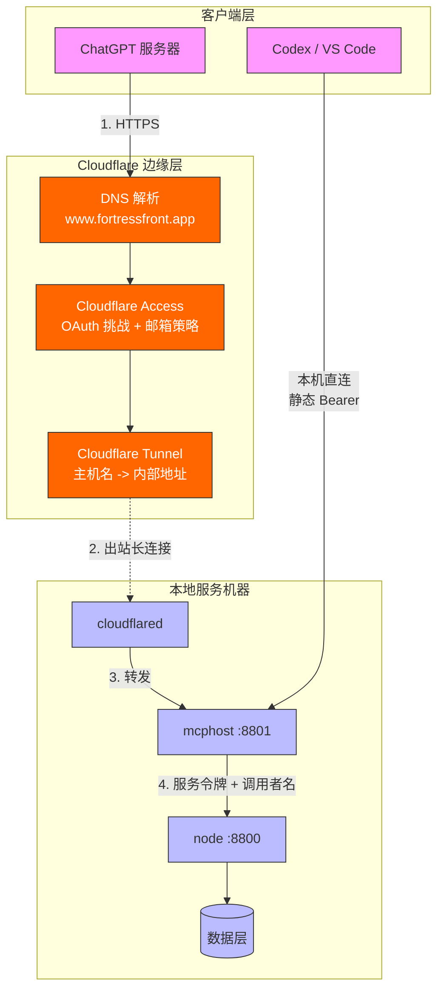
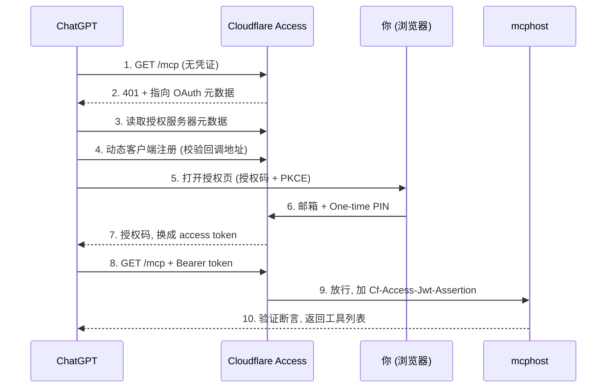

# Cloudflare：把 service 安全地接入公网

目的：让公网上的客户端（目前是 ChatGPT）通过 OAuth 访问本项目的 service（目前是 mcphost），同时不开放任何入站端口，也不暴露 node。

文档分三部分：

1. 当前架构：是什么，数据怎么进来
2. How to：如何搭起来
3. 示例：ChatGPT 如何 OAuth 登录

## 1. 当前架构

### 1.1 总览



### 1.2 各部分的角色

| 部分 | 角色 | 说明 |
|---|---|---|
| 域名 | 公网名字 | `fortressfront.app`，托管在 Cloudflare |
| DNS | 通讯录，不是路由器 | 只负责把名字解析成地址。`www` 这条记录指向 Cloudflare 自己（隧道），所以公网流量先到 Cloudflare，而不是到你的机器 |
| Access | 门卫 | 在 Cloudflare 边缘检查：请求是否持有合法的 OAuth 凭证，登录人是否在策略里 |
| Tunnel | 通向内部的专线 | 内部机器上的 `cloudflared` 主动向外连到 Cloudflare；Cloudflare 按"主机名 -> 内部地址"的规则把请求送回去 |
| mcphost | 应用层入口 | 再次验证 Access 签发的断言，通过后转给 node |
| node | 数据后端 | 只监听 127.0.0.1，只接受 mcphost 的服务令牌 |

路由的职责在 Tunnel 的 Public Hostname 规则里，不在 DNS 里。

### 1.3 数据如何进来（一个请求的全过程）

1. 客户端访问 `https://www.fortressfront.app/mcp`。
2. DNS 把域名解析到 Cloudflare 边缘节点。
3. Access 检查：
   - 没有有效凭证：返回 401，并指明去哪里做 OAuth（见第 3 部分）。
   - 有有效凭证：在请求上加 `Cf-Access-Jwt-Assertion` 头（带签名的身份断言），放行。
4. Tunnel 规则查到该主机名对应的内部地址 `http://127.0.0.1:8801`。
5. 请求沿 `cloudflared` 事先建立的出站连接送到本机的 mcphost。
6. mcphost 验证断言：RS256 签名、`iss`、`aud`、有效期、邮箱在白名单。不通过返回 401。
7. mcphost 带着服务令牌和调用者名（`X-Fortress-Caller`）访问 node，取回数据，原路返回。

要点：

- 连接方向：`cloudflared` 主动向外连。所以不需要公网 IP，不需要开端口，也不受 NAT 影响。
- 两层独立验证：Cloudflare 边缘验证一次，mcphost 用公钥再验证一次。mcphost 不信任"请求来自隧道"这件事本身，只信任带签名的断言。
- node 不在隧道里，公网永远碰不到它。
- 本机客户端（Codex、VS Code）不经过 Cloudflare，直接访问 `http://127.0.0.1:8801/mcp`，用静态 Bearer。

### 1.4 为什么这样设计

- ChatGPT 的连接器是账号级配置，请求由 OpenAI 的服务器发出，不是手机或电脑发出，所以入口必须公网可达。
- ChatGPT 只支持 OAuth，不能发静态 API key。
- Cloudflare Access 的 Managed OAuth 充当 OAuth 授权服务器，不需要自建，也不需要第三方身份服务。

### 1.5 当前配置（在 Cloudflare 控制台，不在仓库里）

| 项目 | 值 |
|---|---|
| 域名 | `fortressfront.app`（Active） |
| Tunnel | 控制台托管，`cloudflared` 作为 macOS 服务运行 |
| Public Hostname | `www.fortressfront.app` -> `http://127.0.0.1:8801` |
| Access 应用 | Fortress Front，Self-hosted，Destination `www.fortressfront.app/mcp` |
| Policy | Allow；Include 仅自己的邮箱；One-time PIN 登录；Session 6 小时 |
| Managed OAuth | 已开启；Allowed redirect URIs 为 ChatGPT 的回调地址 |
| 团队域名 | `fortressfront.cloudflareaccess.com` |

### 1.6 局限

- 机器关机或休眠，隧道断开，公网无法访问。计划把 service 迁到阿里云常驻。
- Access 目前只保护 `/mcp`，该主机名下的其他路径不受 Access 保护。需确认 mcphost 在其他路径上没有暴露内容，或把 Path 留空保护整个主机名。
- 未配置：WAF 规则、限速、认证失败告警。

### 1.7 未来扩展

- 新增 service：加一条 Tunnel Public Hostname 规则（新主机名 -> 内部地址），再建一个对应的 Access 应用。
- 静态网页：可以用 Cloudflare Pages，不经过隧道。需要保护时同样套一个 Access 应用。
- 迁移机器：Cloudflare 侧基本不变。在新机器上用同一个 tunnel token 安装 `cloudflared`，并停掉旧机器上的那个。不要让两台提供不同内容的机器同时跑同一条隧道，请求会被随机分配。
- `www` 不适合做 MCP 入口，之后可改 `mcp.` 子域名：同步修改 Public Hostname、Access 应用、`mcphost.public_hosts`。

## 2. How to：搭建步骤

前置：有 Cloudflare 账号（免费版即可）；本机已能运行 node 和 mcphost，且都只监听 127.0.0.1。

### 步骤 1：域名接入 Cloudflare

1. 买一个域名。可以在 Cloudflare Registrar 买，也可以在别处买后把 nameserver 改成 Cloudflare 给出的两个。
2. 等域名状态变为 Active。

域名严格说是可选的：临时隧道（`trycloudflare.com`）不需要域名，但地址会变，也不能挂 Access，所以长期使用需要域名。

### 步骤 2：创建 Tunnel 并安装 cloudflared

1. Networks -> Tunnels -> Create a tunnel，选 Cloudflared，起个名字。
2. 选 macOS，页面给出安装命令（以页面为准，通常是）：
   - `brew install cloudflared`
   - `sudo cloudflared service install <TOKEN>`
3. 页面显示 connector 已连接即成功。
4. 添加 Public Hostname：
   - Hostname：`www.fortressfront.app` (自定义)
   - Service：`http://127.0.0.1:8801`（注意连接mcphost，不是 node）

添加 Public Hostname 时，Cloudflare 会自动创建对应的 DNS 记录。

TOKEN 等同密码，不要写进仓库或文档。泄露后在控制台刷新 token 并重新生成

### 步骤 3：创建 Access 应用

Zero Trust -> Access controls -> Applications -> Add an application -> Self-hosted -> DNS Application

- 应用名：Fortress Front
- Destination：Public hostname `www.fortressfront.app`，Path `/mcp`

### 步骤 4：设置 Policy 
Access policies中添加policy，比如oauth
- Action：Allow
- Include：Emails，只填自己的邮箱
- Session duration：6 小时

> 不要用域名通配（如 `@example.com`），只放需要的具体邮箱。

### 步骤 5：开启 Managed OAuth
Managed OAuth 下面打开OAuth，设置:
- Allow localhost clients = True
- Allow loopback clients = True

在该 Access 应用的设置里开启 Managed OAuth，并在 Allowed redirect URIs 加入 ChatGPT 的回调（以 OpenAI 当前文档为准）：

- `https://chatgpt.com/connector_platform_oauth_redirect`
- `https://chatgpt.com/connector/oauth/*`

留空会导致 ChatGPT 的动态注册被拒，表现为 "Some app settings were rejected"。

### 步骤 6：配置 mcphost

在 `settings/services.yaml`：

- `mcphost.public_hosts: [www.fortressfront.app]`，否则返回 421 或 403
- `mcphost.access.team_domain`：团队域名 `fortressfront.cloudflareaccess.com`
- `mcphost.access.audience`：Access 应用的 AUD 标签，在应用概览页
- `mcphost.access.users`：允许的邮箱与对应的调用者名

AUD 和团队域名是公开标识，不是密钥。改完后重启 mcphost。

### 步骤 7：验证

```bash
# 未带凭证：应由 Cloudflare 返回 401，并带 OAuth 发现信息
curl -i https://www.fortressfront.app/mcp

# 授权服务器元数据：应返回 200
curl -i https://fortressfront.cloudflareaccess.com/.well-known/oauth-authorization-server
```

如果返回的是 mcphost 自己的 `{"error":"unauthorized"}`，说明 Access 没有挡在前面，检查 Destination 和路径。

### 排错

| 现象 | 原因 | 处理 |
|---|---|---|
| "Some app settings were rejected" | Allowed redirect URIs 为空，动态注册被拒 | 添加 ChatGPT 回调地址 |
| "Authentication succeeded, action discovery failed" | OAuth 成功，但 mcphost 不认 Access 断言，工具列表请求被 401 | 确认 mcphost 已配置 `access` 并重启 |
| 421 / 403 | Host 或 Origin 不在白名单 | 配置 `public_hosts` |
| node rejected the token | mcphost 用了错误的 node 令牌 | 换成 node 的 `mcphost` 服务令牌 |

## 3. 示例：ChatGPT 如何 OAuth 登录

### 3.1 操作

1. ChatGPT -> Settings -> Connectors（或 Apps）-> 添加自定义 MCP 连接器。
2. URL 填 `https://www.fortressfront.app/mcp`。
3. 认证方式选 OAuth。
4. 点击连接，浏览器跳到 Cloudflare 登录页。
5. 输入自己的邮箱，到邮箱里收验证码（One-time PIN）并填入。
6. 同意授权，页面返回 ChatGPT，连接器显示已连接，ChatGPT 列出 mcphost 提供的工具。

邮箱不在 Policy 里的人收不到验证码，也就拿不到令牌。

### 3.2 背后发生了什么



1. ChatGPT 先不带凭证访问，被 Access 以 401 拒绝，响应里带 OAuth 发现信息。
2. ChatGPT 读取授权服务器元数据，并动态注册自己为客户端。回调地址不在 Allowed redirect URIs 里就在这一步失败。
3. ChatGPT 用授权码流程加 PKCE（S256）引导你登录。你完成邮箱验证后，ChatGPT 拿到令牌，并可用 refresh token 续期。
4. 之后每次调用都带令牌。Access 在边缘验证令牌，通过后加上 `Cf-Access-Jwt-Assertion` 再放行。
5. mcphost 验证这个断言（签名、`iss`、`aud`、邮箱），通过后把请求以你的调用者名转给 node。

### 3.3 如何确认成功

- mcphost 日志里应有 `tool start` / `tool ok`，调用者名是自己配置的名字（如 `xingxing`），没有 `auth rejected`。
- 在 ChatGPT 里让它列出数据集、查看 schema，做一次聚合查询。
